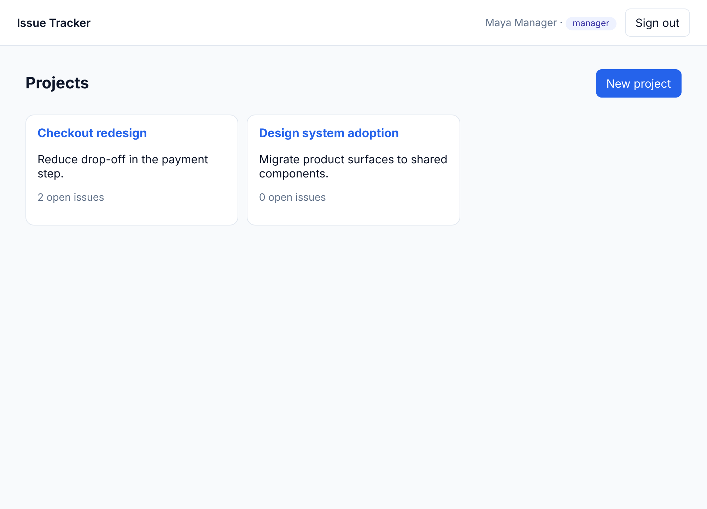
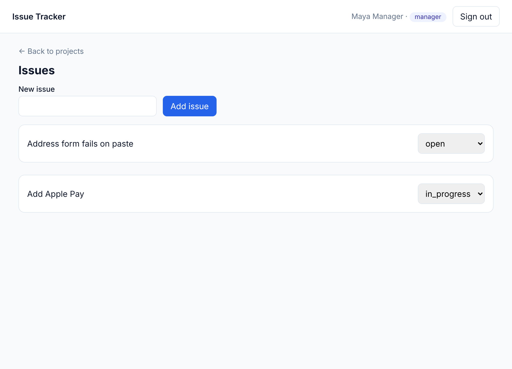

# Angular Enterprise — Issue Tracker

A production-shaped Angular 19 application: an internal project/issue tracker with role-based access, built with **standalone components, signals, RxJS, typed reactive forms, functional guards and interceptors, lazy-loaded routes** and a mock backend so it runs with no server.

| Projects | Issues (manager) |
|---|---|
|  |  |

> This is the Angular counterpart to my React issue tracker — same domain, idiomatic in each framework — so the architectural choices can be compared directly.

## Highlights
- **Standalone, NgModule-free.** Components, directives and lazy routes are all standalone (Angular 19 default).
- **Signals for state.** `AuthService` and the feature services expose state as signals (`user`, `isAuthenticated`, `projects`, `loading`, `error`); components read them directly, with `computed` for derived values like the current role.
- **RxJS where it fits.** HTTP flows and the optimistic issue-status update (with rollback) use RxJS operators; UI state uses signals. The two are not mixed up.
- **Authorization as permissions, not role checks.** `can(role, 'issue:update')` drives a structural directive `*appHasPermission`, a functional `permissionGuard`, and route guards — never `role === 'admin'` scattered through the UI. The mock backend enforces the same rules server-side (403s), because UI checks are affordances only.
- **Functional interceptors.** `authInterceptor` attaches the token; `errorInterceptor` normalizes `HttpErrorResponse` into a small `AppError` and signs the user out on 401.
- **Typed reactive forms** with `nonNullable` form groups and inline validation.
- **Lazy routes** — login, projects, issues and the forbidden page are each their own bundle (see the build output).

## Architecture
```
src/app/
  core/
    models.ts                 domain types
    auth/  permissions.ts · auth.service.ts (signals)
    http/  auth.interceptor · error.interceptor (functional)
    guards/ auth.guard · permissionGuard (functional)
  shared/ has-permission.directive.ts   (structural, permission-gated)
  features/
    auth/      login (reactive form)
    projects/  list + create (signals service)
    issues/    list + create + optimistic status (signals service)
  mock/ mock-backend.interceptor.ts     in-memory API (dev + tests)
```

## Run it
```bash
pnpm install
pnpm start                 # http://localhost:4200
pnpm lint
pnpm test:ci               # headless Chrome (set CHROME_BIN if not on PATH)
pnpm build
```
Demo accounts (password `password`): `admin@example.com`, `manager@example.com`, `viewer@example.com`.

## Testing
Karma + Jasmine, headless Chromium. 16 tests:
- **Permissions** — the matrix and that roles are strictly nested supersets.
- **AuthService** — login stores user/token and derives permissions; logout clears state.
- **IssuesService** — loads into signals; optimistic status update; **rollback on server error**.
- **Guards** — `authGuard` redirects with `returnUrl` and allows authenticated users; `permissionGuard` allows/forbids by permission.
- **HasPermissionDirective** — renders/hides content by permission (host-component test).
- **LoginComponent** — rejects an invalid form; surfaces a normalized server error (with the real `errorInterceptor` wired in).

## Trade-offs and limitations
- **Mock backend.** The API is an in-memory HTTP interceptor; data resets on reload. The services, forms, guards and RxJS pipelines are real and would point at an HTTP API unchanged — only `app.config.ts` drops the mock interceptor.
- **Token storage** mirrors the access token to `localStorage` so a reload restores the session. A production app should use an httpOnly cookie; noted here deliberately.
- Custom lightweight styling rather than Angular Material, to keep the focus on architecture (my component-library project covers the CDK/design-system side).
- No NgRx here — state is small and signals suit it; a separate project demonstrates NgRx for larger state.
- Zone.js change detection (Angular 19 default); the app is structured so a move to zoneless is mechanical.

## License
MIT
